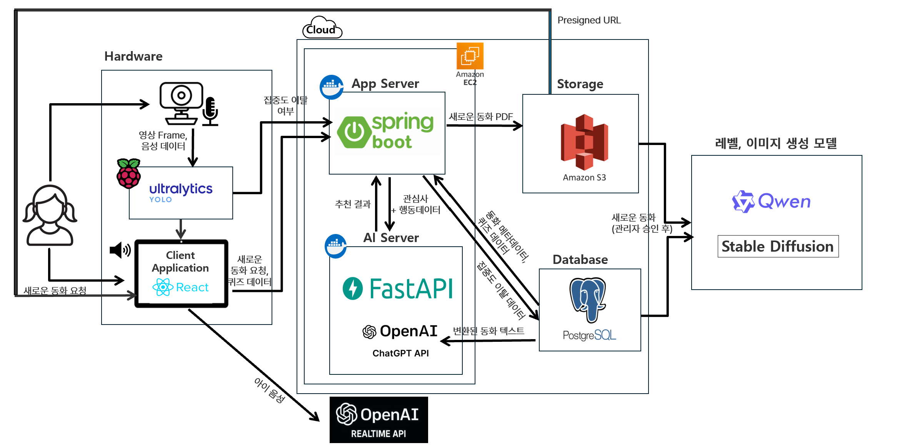

# 📖 StoryDream

### YOLO-Pose와 LLM을 활용한 라즈베리파이 기반 인터랙티브 동화 서비스

**StoryDream**은 5~7세 아동을 위한 AI 기반 맞춤형 동화 서비스입니다. (<a href="https://www.youtube.com/watch?v=QfPyULg7yuI"> 시연 영상
</a>)


기존 전자책의 단방향 독서 방식에서 벗어나, 아동의 **관심사 / 이해도 / 집중 상태**를 반영하여 능동적인 독서 경험을 제공합니다.

YOLO-Pose 기반 실시간 집중도 감지, LLM 기반 난이도 조절, 음성 상호작용을 통해 아동의 독서 몰입을 유도하고, 보호자에게 AI 독서 분석 리포트를 제공합니다.


<h2>👥 팀원</h2>

- **프로젝트 기간 : 2026.04 - 2026.11 (7개월)**

| 담당자 | 역할 | 주요 업무 |
| :----: | :--: | --------- |
| <a href="https://github.com/eunkyoung529"></a><br>[김은경](https://github.com/eunkyoung529) | PM<br>AI/BE/HW | StoryDream 기획<br>SDXL LoRA fine tuning 및 이미지 동화 삽화 생성<br>LLM LoRA fine tuning 및 단계별 동화데이터 생성<br>집중도 여부 판단 Yolo-Pose 파이프라인 구축<br>실시간 상호작용 모듈 개발 및 개선<br>회원가입/로그인 구현<br>FastAPI AI 서버 구축 및 LLM 기반 독서 리포트 생성 기능 구현<br>HW-SW 연동<br>라즈베리파이 환경 구축 및 하드웨어 LED, 엔코더 기능 구현|
| <a href="https://github.com/Arin0303"></a><br>[남아린](https://github.com/Arin0303) | FE/BE/Infra | 동화 읽기, 퀴즈, 아동 프로필 등 핵심 API 개발<br>아동 수준별 난이도 계산 로직 구현<br>추천 시스템 연동 및 캐시 적용<br>시작, 로그인, 아동 관리, 리포트 화면 등 프론트엔드 개발<br>디자인, UI/UX 구현<br>Docker, AWS S3, CI/CD 배포 환경 구축<br>라즈베리파이-백엔드 통신 구현 |
| <a href="https://github.com/hyunsun276"></a><br>[유현선](https://github.com/hyunsun276) | FE/AI | 프론트엔드 초기 환경 구축<br>동화 추천, 동화 읽기, 퀴즈, 상호작용 화면 개발<br>관심사 추출 및 행동 기반 추천 파이프라인 및 오프라인 평가 구현<br>화면 이탈 감지 기반 상호작용 흐름 구현<br>소셜 로그인 프론트엔드 구현 |
<br>


## ✨ 주요 기능

| 기능                   | 설명                                                                    |
| ---------------------- | ----------------------------------------------------------------------- |
| 📚 맞춤형 동화 추천     | 아동의 관심사와 실제 독서 행동을 반영한 개인화 추천                     |
| 🎯 난이도 자동 조절     | 퀴즈 정답률과 집중도에 따라 동화 난이도(Level 1~3) 조절                 |
| 👀 실시간 집중도 감지   | YOLO-Pose를 활용한 얼굴 방향(FRONT/SIDE/BACK/ABSENT) 분류 및 집중 이탈 감지  |
| 🎤 실시간 음성 상호작용 | 집중 이탈 시 AI 캐릭터가 동화 관련 질문을 생성하고 아동의 답변에 반응   |
| 📊 AI 독서 리포트       | 독서 이력, 퀴즈 정답률, 난이도 변화, 집중도 데이터를 종합한 분석 리포트 |

## 🛠 기술 스택

| 구분           | 기술                                                       |
| -------------- | ---------------------------------------------------------- |
| Frontend       | React 19, TypeScript 6, Vite 8                             |
| Backend        | Java 21, Spring Boot 4.1, Spring Data JPA, Spring Security |
| AI Server      | Python, FastAPI                                            |
| AI / ML        | YOLO-Pose, Qwen2.5-7B, SDXL, OpenAI Realtime API|
| Database       | PostgreSQL                                                 |
| Infrastructure | AWS EC2, RDS, S3, Docker, Nginx, GitHub Actions, Vercel    |
| Hardware       | Raspberry Pi 4, Webcam, Speaker, LED, Encoder              |

## 🏗 시스템 구성

StoryDream은 **React 클라이언트, Spring Boot 백엔드, FastAPI 기반 AI 서버, 라즈베리파이 하드웨어**로 구성됩니다.

- **Frontend:** 동화 탐색 및 읽기, 아동 프로필 관리, 퀴즈, 독서 리포트 UI
- **Backend:** 사용자 인증, 동화 및 독서 이력 관리, 추천·퀴즈 API
- **AI Server:** 맞춤형 동화 추천, 난이도 조절, AI 리포트 생성
- **Realtime AI:** YOLO-Pose 기반 집중도 감지 및 실시간 음성 상호작용
- **Hardware:** 라즈베리파이 기반, LED 및 엔코더를 활용한 인터랙션
- **Infrastructure:** AWS 기반 데이터 저장 및 서버 운영

## 🚀 핵심 기술 및 성과

### 1. 관심사 및 행동 기반 동화 추천
- 관심사 유사도(70%)와 독서 행동 유사도(30%)를 결합한 개인화 추천
- 임베딩 캐싱을 통해 반복 API 호출 최소화
- 캐시 적용 시 임베딩 처리 시간 **98.75% 감소**

### 2. 생성형 AI 파인튜닝
- Qwen2.5-7B + LoRA 기반 아동 수준별 동화 문장 생성
- SDXL + LoRA 기반 동화 스타일 삽화 생성
- 파인튜닝 후 BERTScore 약 **9%**, Style-aware CLIP Score 약 **11% 향상**

### 3. YOLO-Pose 기반 실시간 집중도 감지
- YOLO-Pose 모델을 활용한 얼굴 방향 분류
- 최근 8회 판정 결과를 활용한 오탐 완화
- 집중 이탈이 10초 이상 지속되면 음성 상호작용 실행


## 🏗 시스템 구성도



- **Frontend:** 동화 탐색 및 읽기, 아동 프로필 관리, 퀴즈, 독서 리포트 UI
- **Backend:** 사용자 인증, 동화 및 독서 이력 관리, 추천·퀴즈 API
- **AI Server:** 맞춤형 동화 추천, 난이도 조절, AI 리포트 생성
- **Realtime AI:** YOLO 기반 집중도 감지 및 실시간 음성 상호작용
- **Infrastructure:** AWS 기반 데이터 저장 및 서버 운영

## 📁 프로젝트 구조

```text
story-dream/
├── frontend/          # React 기반 웹 클라이언트
├── backend/           # Spring Boot API 서버
├── AI/                # AI 서버 및 실시간 상호작용
├── hardware/          # 라즈베리파이 하드웨어 관련 코드
├── .github/           # GitHub Actions 워크플로
└── docker-compose.yml # 컨테이너 실행 설정
```